# 机械组开发日志

> **队伍名称**：破囚战队
> **记录周期**：2026 年 9 月 21 日 — 10 月 18 日
> **文档编写**：宋至人
> **说明**：本文档为机械组专项日志，统一以「机械组」指代。
> **成员**：熊帅星

---

## 一、组内职责与技术路线

机械组负责机器人的**全部物理结构**：底盘装配、机械臂设计、夹爪与车斗、3D 建模与打印。

我们的技术路线是"**实物 → 测量 → 建模 → 打印 → 装配 → 迭代**"：先拿到真实底盘，测出实际尺寸，再在三维软件中建模，打印后装配，最后根据实际问题反复调整参数。

| 时间 | 里程碑 |
|---|---|
| 9/21-9/27 | 底盘装配、车轮舵机安装 |
| 9/30 | 完成数据采录及**底盘模型化** |
| 10/8 | 完成**机械臂初版设计** |
| 10/10 | 机械臂**从五轴简化为三轴** |
| 10/11 | 完成**第一平台**（机械臂安装平台）设计 |
| 10/14 | **机械臂组装完成** |
| 10/16-10/17 | 对部件进行**数次参数调整**、前臂关节重新打样 |
| 10/18 | 完成**第二平台与车斗**设计 |

---

## 二、底盘装配与模型化

### 2.1 物料、图纸与实际尺寸

首批物料到位后，我们发现**底盘实物比预期大**。底盘板为 4 轮金属底盘，图纸标注约 **255mm×150mm**，与手册尺寸规范（≤290×195×210mm）基本匹配，这为后续建模提供了基准。

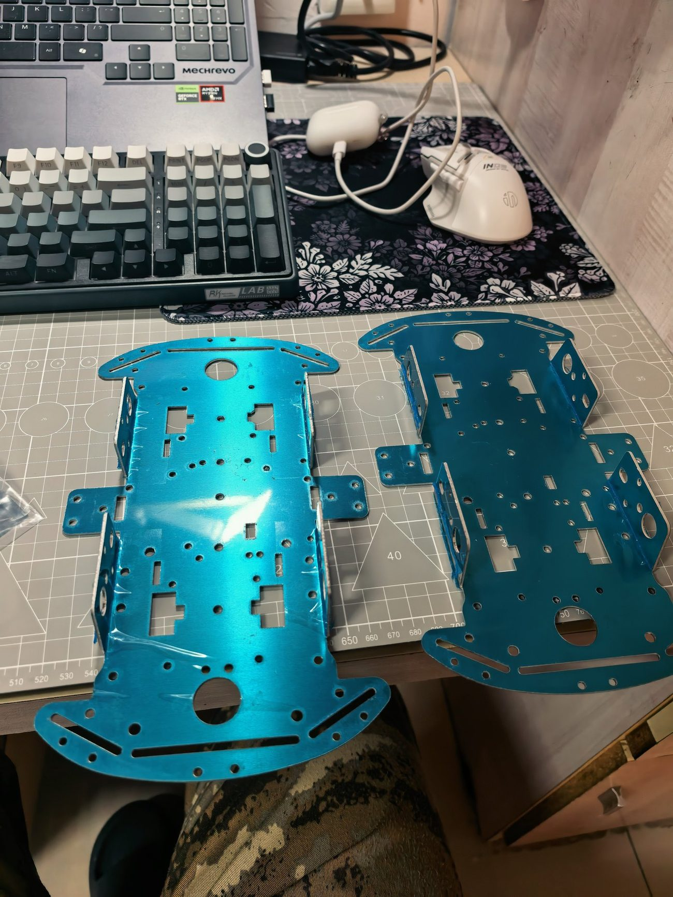
*图 1：首批物料到位（底盘、舵机、驱动模块、线材）*

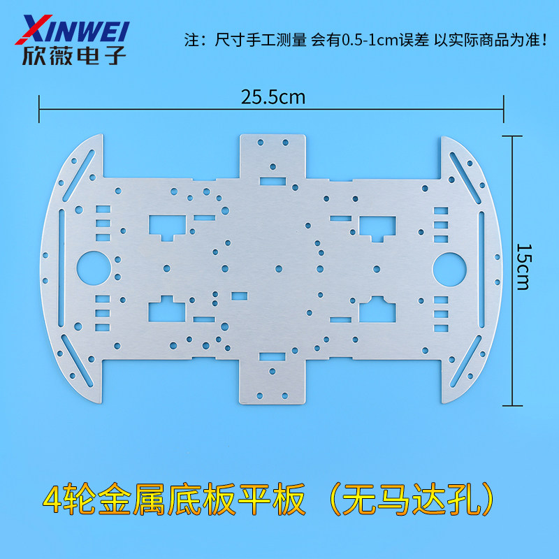
*图 2：底盘板图纸（25.5cm × 15cm）*

> **为什么强调"先实物、后建模"**：商家只提供了有限的图纸数据，**实际尺寸必须自己测量**。我们正是用游标卡尺完成数据采录，才保证了后续 3D 模型与实车能对得上。

### 2.2 装配完成（9 月 27 日）

四个麦轮与舵机安装到位。这一步踩了两个坑：

| 问题 | 现象 | 处理 |
|---|---|---|
| 螺母漏发 | 轮胎无法拧紧、**四轮不能等高** | 自行补购紧固件 |
| 尺寸规范更新 | 分工文档用的是旧尺寸（260 版） | 以手册 V1.4（290）为准重核 |

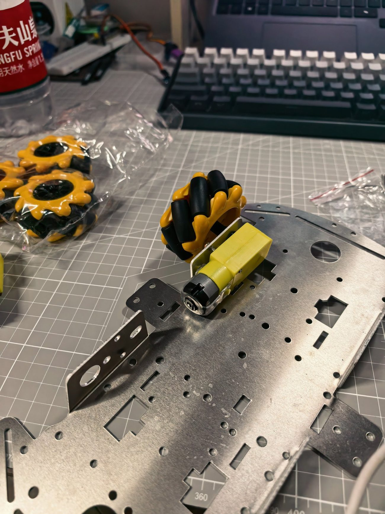
*图 3：四轮麦克纳姆轮底盘装配完成*

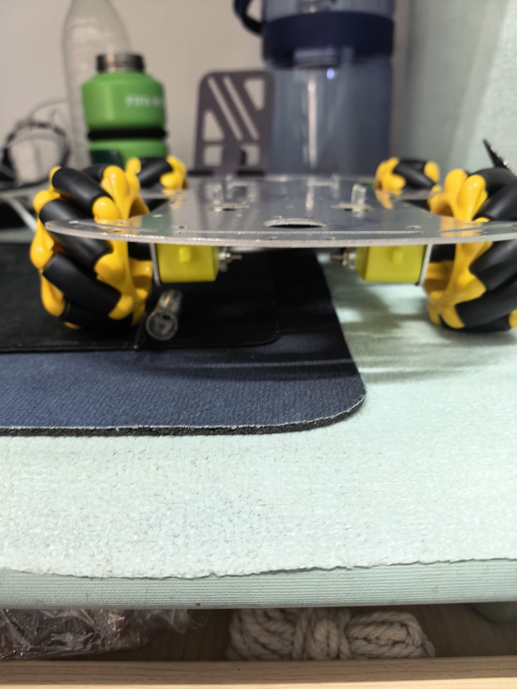
*图 4：底盘俯视细节——麦轮排列与舵机安装*

### 2.3 底盘模型化（9 月 30 日）

完成数据采录后，在三维软件中建立底盘模型。模型化的价值在于：**后续的机械臂底座、平台、车斗都可以在同一个坐标系下设计与验证装配关系**，而不是靠"目测差不多"。

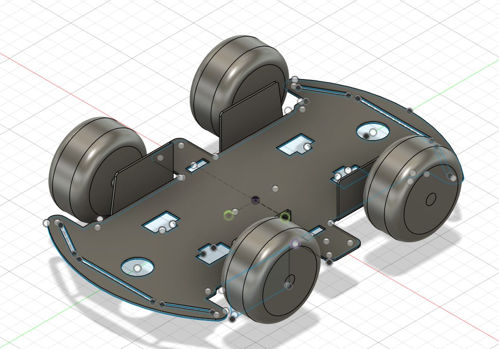
*图 5：四轮麦轮底盘的 3D 建模*

---

## 三、高低底盘与轮系的选型决策

### 3.1 为什么做"高低底盘"对比

9 月 30 日，团队围绕"高底盘还是低底盘"展开讨论。机械组没有直接拍板，而是把两种方案系统列出：

| 对比维度 | 高底盘 | 低底盘 |
|---|---|---|
| 通过性 | 强（离地间隙大） | 一般 |
| 操控稳定性 | 较差（重心高、侧倾明显） | **好（重心低、响应直接）** |
| 高速稳定性 | 易发飘 | **贴地感强** |
| 抓取便利性 | 机械臂位置高 | **机械臂更贴近地面** |
| 抗侧翻 | 弱 | **强** |

讨论中的关键判断：
- "**高底盘重心不稳的问题更明显**"——对抗中容易侧翻；
- "**高底盘怕摔车**"——赛场会受到冲撞；
- "**高底盘抓不着就尴尬了**"——机械臂太高反而难抓地面方块。

**最终确定低底盘方案。**

> **技术决策依据**：① 场地平整，"通过性"优势无法体现；② 对抗赛有冲撞，低重心抗侧翻更强；③ **低底盘让夹爪更贴近地面，缩短机械臂行程、降低舵机负载**——这一点后来被舵机损坏问题反向验证。

### 3.2 轮系：四轮麦克纳姆轮

采用四轮麦轮，实现横移与原地旋转。运动学关系（简化）：

```
vX  = (v1 + v2 + v3 + v4) / 4        （前后）
vY  = (-v1 + v2 + v3 - v4) / 4       （左右）
ω   = (-v1 + v2 - v3 + v4) / (4·L)   （旋转）
```

> **为什么选麦轮**：赛场"转身"比"直线速度"更重要。麦轮的全向能力可以显著缩短对准时间。代价是需要四电机协同解算，由电控组在程序中实现。

---

## 四、机械臂设计：从五轴到三轴

### 4.1 收集机构的形式：钩爪 vs 夹爪

团队曾讨论"要不要做钩爪"，最终对比后选择夹爪：

| 方案 | 优点 | 缺点 | 结论 |
|---|---|---|---|
| 钩爪 | 结构简单、对定位要求低 | 难以稳定"持有"，运输易掉落 | ✗ 不满足"保持携带" |
| **夹爪** | **夹持稳定、可长时间保持** | 对舵机扭矩与结构精度要求高 | ✓ 采用 |

结论原话是："**夹爪吧，钩爪技术力不够**"——这是对自身能力的清醒认识，也是基于考核要求的判断。

### 4.2 机械臂初版设计（10 月 8 日）

初版机械臂采用**五轴**方案（追求姿态灵活）：

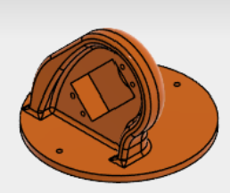
*图 6：机械臂底座与转台的 3D 建模*

### 4.3 关键简化：五轴 → 三轴（10 月 10 日）

**为什么改**：五轴需要更多舵机，成本、重量、调试复杂度都超标；而赛题核心是"**夹起并携带**"，不是复杂抓取姿态。

**结论**：简化为**三轴**——用最少的舵机完成"下降—夹取—抬升"的动作链。


*图 7：机械臂关节零件建模（三轴方案）*

> **这是本次设计中最重要的一次取舍**：从"能做更多动作"退回到"把必要动作做稳"。**在有限舵机与时间下，可靠性优先于灵活性。**

### 4.4 第一平台设计（10 月 11 日）与组装（10 月 14 日）

第一平台是机械臂与底盘的连接结构。设计时重点考虑两点：**底座刚性**（避免夹取时整体晃动）与**重心位置**（机械臂在前，需在后方配重）。

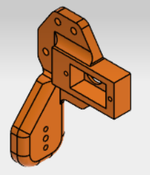
*图 8：夹爪机构建模*

10 月 14 日机械臂组装完成。

### 4.5 参数调整与前臂重新打样（10 月 16-17 日）

组装后经过实际驱动验证，暴露出**前臂关节结构问题**（装配公差、舵机行程干涉），机械组对前臂关节进行**重新打样**，并对多个部件做了数次参数微调。

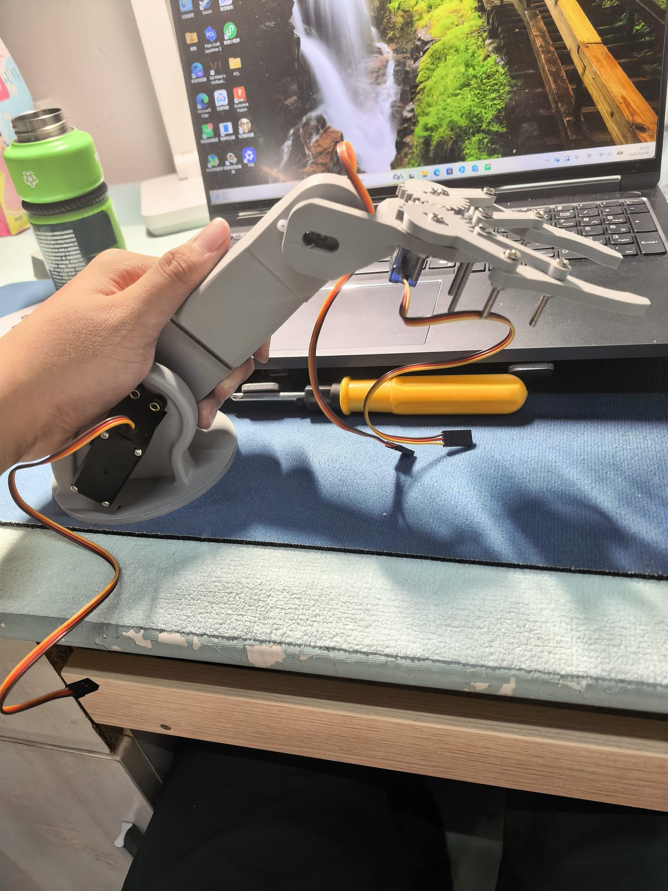
*图 9：3D 打印件实物与装配（手工修配）*

> **为什么反复打样**：3D 打印的优势正是"改一个参数、重打一个件"。**我们把"打印—装配—发现问题—改模型"当成一个快速迭代闭环**，而不是一次成型。

### 4.6 第二平台与车斗（10 月 18 日）

在机械臂稳定后，完成了**第二平台**（承载电控与电池）与**车斗**（收集/暂存方块）的设计。

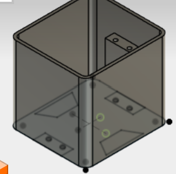
*图 10：车斗（方块收集容器）建模*

> **车斗的意义**：赛题要求机器人"收集并占有"方块。**夹爪负责"抓"，车斗负责"存"**——两者配合才能在一次往返中搬运更多方块，这是从"能夹"到"能收集"的能力升级。

---

## 五、夹爪实拍

以下为夹爪抓取测试的视频抽帧，可以看到"接近—夹持—抬升"的完整动作：

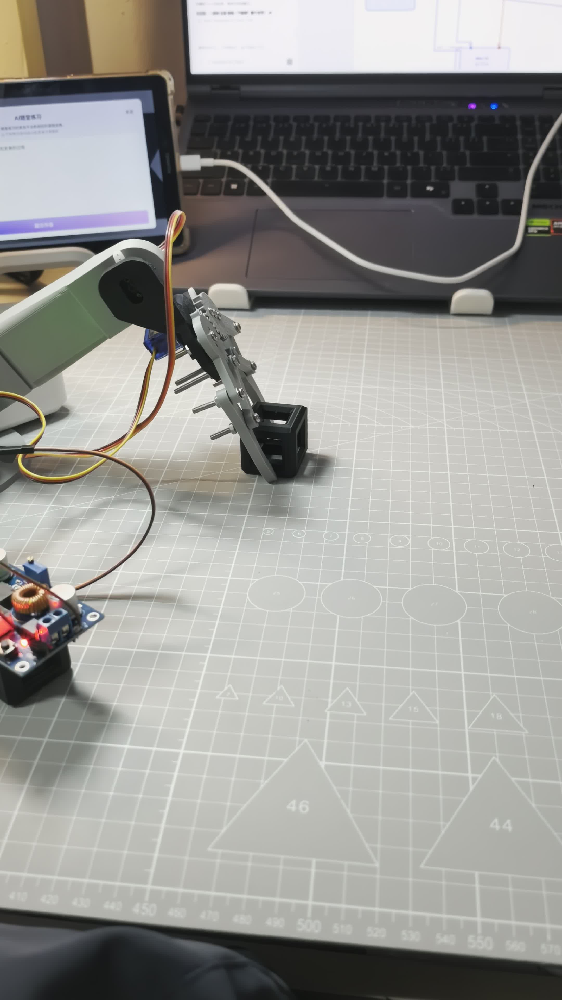
*图 11：夹爪下降接近地面方块*


*图 12：夹爪夹住方块并抬升*

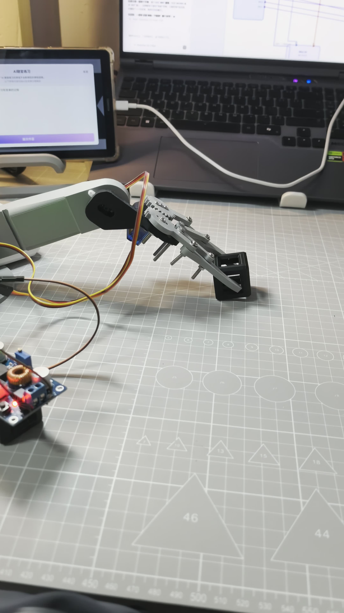
*图 13：夹持状态下移动，验证"保持携带"*

---

## 六、结构强度与尺寸控制

| 规范项 | 要求 | 我们的做法 |
|---|---|---|
| 尺寸 | 初始 ≤ 290×195×210mm（V1.4） | 低底盘 + 紧凑布局，注意 V1.4 新数值 |
| 重量 | ≤ 2.0kg | 轻量化底盘 + 3D 打印件 |
| 结构强度 | 180mm 自由下落无零件掉出 | 螺丝紧固为主，减少热熔胶 |
| 走线 | 线路不过度裸露 | 预留走线空间，规划分层布线 |

> **教训**：手册在备赛期间会更新（V1.4 把尺寸从 260 放宽到 290），**任何"从旧文档抄来的尺寸"都可能让整个设计作废**。我们由此建立"以手册最新版为准"的核对习惯。

---

## 七、问题汇总

| # | 问题 | 原因 | 解决 |
|---|---|---|---|
| 1 | 底盘实际偏大 | 到货与预期不符 | 重新核算布局 |
| 2 | 螺母漏发、四轮不等高 | 商家漏发 | 补购紧固件 |
| 3 | 工具寄错地址 | 采购信息错误 | 重买 |
| 4 | 尺寸用旧数字 | 手册更新未同步 | 以 V1.4 为准重核 |
| 5 | 机械臂五轴过重 | 舵机/成本超标 | 简化为三轴 |
| 6 | 前臂关节干涉 | 装配公差 | 重新打样 |
| 7 | 舵机连续损坏 | 塑料齿 + 过载卡死 | 换金属齿、加限位 |
| 8 | 重心偏移 | 机械臂单侧 | 后方加车斗配重 |

---

## 八、小结

机械组完成了：**底盘装配与模型化 → 机械臂设计（五轴→三轴）→ 第一平台 → 组装 → 参数迭代 → 第二平台与车斗**的完整链条。

最大的收获是学会了"**用数据做结构决策**"：高低底盘不是凭感觉选，而是逐项对比后得出结论；机械臂不是越复杂越好，而是**在舵机预算内把必要动作做到最稳**。后续将继续完善夹爪限位结构、车斗容量与 3D 打印件的强度验证。

---

*本文档为机械组专项日志，总体设计见 [总体篇](./00-总体设计与开发日志.md)。*
