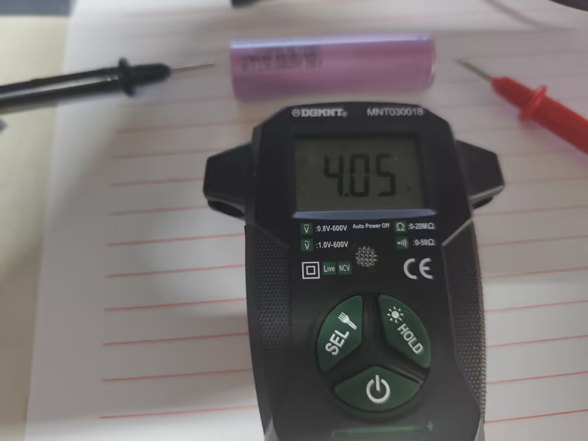
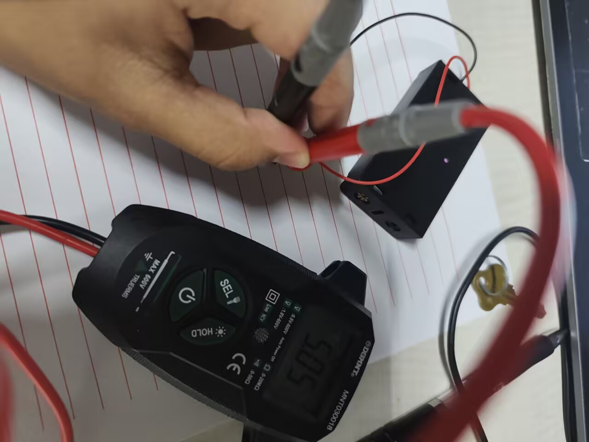
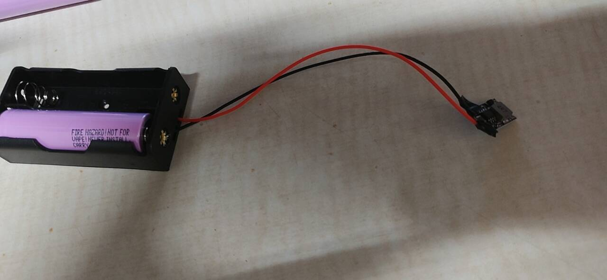
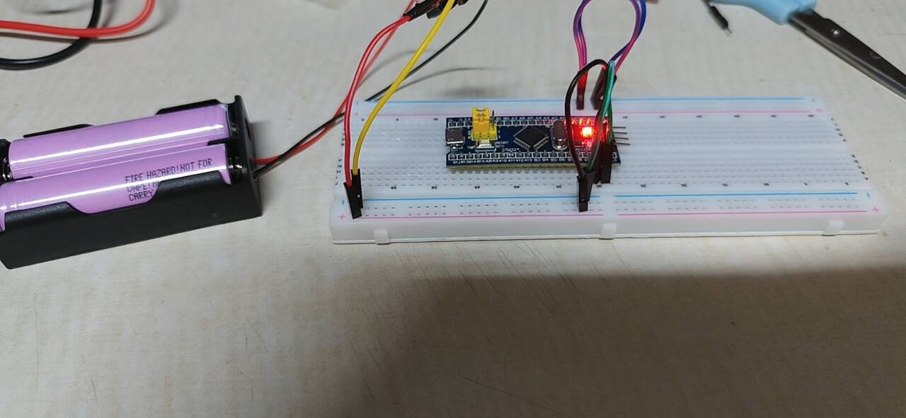
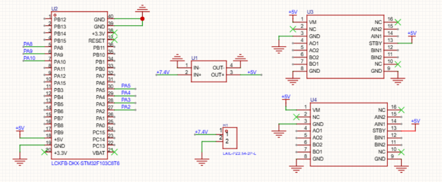
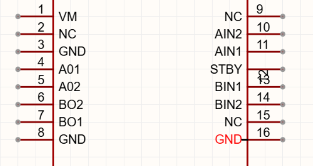
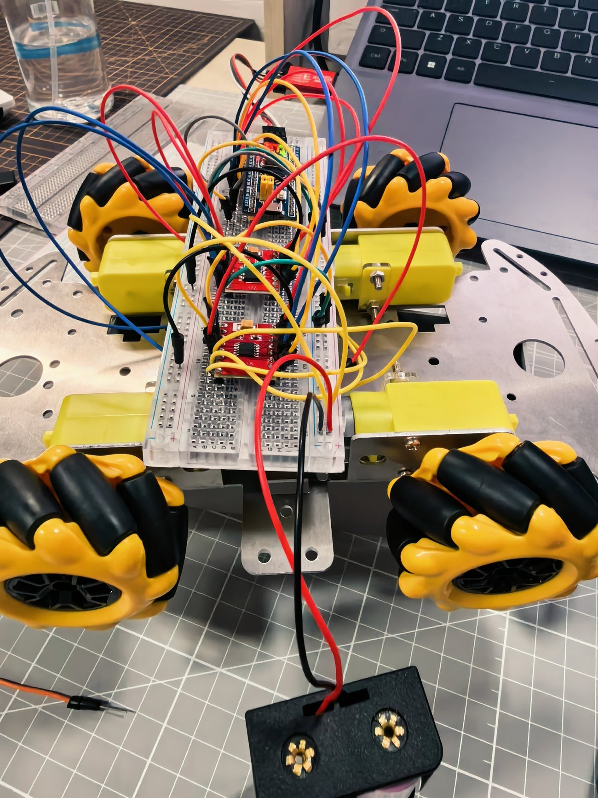
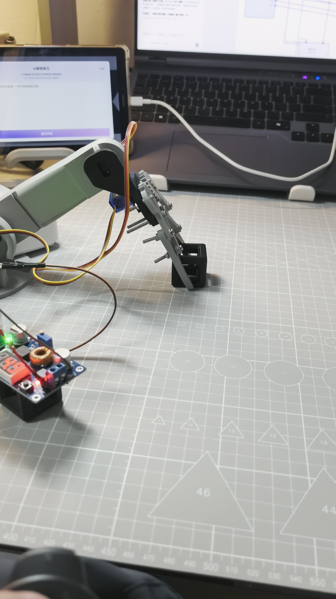

# 电控组开发日志

> **队伍名称**：破囚战队
> **记录周期**：2026 年 9 月 20 日 — 10 月 18 日
> **文档编写**：宋至人
> **说明**：本文档为电控组专项日志，统一以「电控组」指代。
> **成员**：张奥；刘俊鑫

---

## 一、组内职责与技术路线

电控组负责机器人的"神经系统"：**供电链路、主控程序、电机/舵机驱动、PS2 遥控**。

我们采用的是一条"从零搭建"的路线——所有代码基于 STM32F103C8T6 自行编写，所有电路自行焊接，没有直接套用现成小车方案。

| 时间 | 里程碑 |
|---|---|
| 9/20-9/25 | 通过江科大教程系统学习 STM32 基础（GPIO、定时器、PWM、串口） |
| 9/27 | 完成底盘装配 |
| 10/1 | 完成单个电机驱动，单个麦轮可动 |
| 10/9 | 完成底盘运动电路搭建 |
| 10/13 | 完成底盘全向运动 |
| 10/14 | 完成 PS2 与 STM32 通信，实现摇杆比例调速 |
| 10/18 | 完成机械臂运动控制与能量方块夹取测试 |

---

## 二、供电链路：从"能测电压"到"能稳定供电"

### 2.1 学习安全地测量电池（10 月 3 日）

**学习内容**：锂电池安全规范（充放电、不短接、不反接）、万用表测电压的正确用法。

**实测**：三星 30Q 18650，单节 **4.05V / 4.11V**，两节串联 **8.21V**。

*图 1：万用表实测单节 18650 电压 4.05V*

> **为什么先做这一步**：18650 是最容易出安全问题（过充、短路、反接可能起火）的部件。**在接任何电路之前，先确认电池状态和测量方法**，是电控的基本纪律。

### 2.2 电池盒的两个坑与"卡片取电池"

**问题**：
1. 电池装进电池盒后**难以拆下**（卡簧紧，手指抠不出）；
2. 万用表表笔接触电池盒红黑线头**不稳定**，读数跳动。

**解决**：
1. 用**卡片从侧面翘出**电池（避免金属工具撬，防止短路）；
2. 表笔**直接触电池盒金属片**，不碰松动的线头。

*图 2：表笔直接抵住电池盒金属片，读数 5.05V（降压后）*

### 2.3 接降压模块：发现"焊盘陷阱"

降压模块（Mini DC-DC 3A/5V）**只有焊盘、没有排针孔**，导线无法插接。我们尝试了"**绕线法**"：剥长铜线 → 缠在焊盘上 → 电胶带包裹。

*图 3：电池盒线缠绕在降压模块焊盘上，电胶带固定*

**结果：失败。** 原因：焊盘有缺口，绕线易脱落；电胶带只能固定不能导电，接触电阻不稳定。

**结论**：必须焊接排针，用杜邦线母头连接。

### 2.4 首次点亮主控

把电池盒（两节 18650 串联，约 7.4V）经降压模块接到面包板，给 STM32F103C8T6 供电。

*图 4：两节 18650 降压后给面包板上的 STM32 核心板供电，指示灯亮起*

> **为什么把失败写进文档**：这是整个电控过程中最有价值的一次试错——它让我们明白**"能通电"不等于"能可靠通电"**。绕线法在实验室"碰巧能用"，放到赛场（振动、碰撞）必然掉线。这直接推动了后面"焊接排针 → 画 PCB"的升级。

### 2.5 电源方案的关键教训（踩坑最多）

**坑 1：把降压后的 5V 接到电机驱动 VM 上**
—— 导致电机转速很慢、部分电机不转。
**纠正**：电机 VM **必须用电池原始 7.4V**，降压后的 5V 只能供主控和舵机。

**坑 2：脱机供电后主控不亮**
—— 原因是 5V 与 GND 没有同时可靠接到主控，存在虚接。
**解决**：直接从降压模块飞线到主控的 5V 脚和 GND 脚，并确保**全系统共地**。

**坑 3：电池盒金属触点明显发热**
—— 判断为廉价电池盒接触电阻过大，属于电源瓶颈。
**解决**：更换接触更好的电池盒。

### 2.6 PCB 设计（10 月 10 日之后）

参加电控与硬件培训后，系统认识了**程序 → 针脚 → 供电链路**的构建关系、PCB 的作用、嘉立创 EDA 的用法。

**决定**：用 PCB 板进行线路搭建与供电。

*图 5：嘉立创 EDA 原理图——U2 STM32F103C8T6、U1 降压模块（7.4V→5V）、U3/U4 DRV8833 双路驱动*

| 模块 | 器件 | 作用 |
|---|---|---|
| U2 | STM32F103C8T6 | 主控，引出 PA/PB/PC 全部引脚 |
| U1 | 降压模块 | 7.4V → 5V |
| U3/U4 | DRV8833 ×2 | 四路电机驱动 |
| J1 | 7.4V 接口 | 电池输入 |

*图 6：DRV8833 引脚——VM 电源、AO/BO 双路输出、AIN/BIN 方向控制、STBY 使能*

> 📄 **原理图文件**：[PCB 原理图（立创 EDA 导出 PDF，198KB）](./images/pcb_schematic.pdf)
>
> 完整可下载，包含 STM32 主控、降压模块、双路 DRV8833 驱动的全部引脚连接。

### 2.7 细节优化：电池盒加装船型开关

反复拆接电池非常繁琐。**解决**：给电池盒焊接**船型开关**——红线接开关一头，另一头焊公头，实现"一键通断电"。

> **工程思维**：用一个小改动解决高频痛点。**开关虽小，却把"每次拆装"变成了"按一下"**，大幅提升了调试效率。

---

## 三、开发环境与烧录：三个典型故障

### 3.1 SWD 烧录报 "Unable to get core ID"

**原因**：CubeMX 工程里没有开启调试接口。
**解决**：在 `.ioc` 中把 **PA13/PA14 设为 Serial_Wire**，重新生成代码。

### 3.2 烧录时检测不到 ST-Link

**原因**：供电切换导致。
**解决**：采用"**烧录时接 ST-Link、运行时接 USB**"的方式；连接异常时用 **BOOT0=1 → 复位 → 烧录 → BOOT0=0 → 复位** 的流程恢复。

> **经验**：STM32 的烧录问题，80% 出在"调试接口没开"和"供电/连接顺序"上。**先把这两项排除，再怀疑芯片。**

---

## 四、接线与接触：用"分段验证"定位问题

### 4.1 四个电机完全不转

**排查**：用万用表逐段测量，发现电池、电机本身都正常，问题出在**面包板与杜邦线的虚接**。

**两步排查法**：
1. **电机直接接电池** → 验证电源与电机是否正常；
2. **飞线直连** → 排除面包板的影响。

最终确认是接触问题，更换新面包板并重新接线后，四个电机恢复正常。

### 4.2 面包板电源轨中间断开

**现象**：同一排的元件有的通电、有的不通。
**原因**：面包板的电源轨在中间是断开的。
**解决**：把同一网络的线集中接到同一段轨道上。

> **方法论**：**遇到"不工作"，先怀疑接触和供电，再怀疑程序**。用最简单的手段（万用表、飞线、指示灯）分段验证，比反复改代码有效得多。

---

## 五、电机与运动控制

底盘运动电路的实拍——四个麦轮、DRV8833 驱动模块与面包板接线：

*图 7：四轮麦轮底盘 + DRV8833 驱动电路（轮子已装配，可受控驱动）*

### 5.1 轮子转向相反

四个电机都能转后，发现个别轮子转向相反。
**解决**：把该电机的两根输出线对调。

### 5.2 从"开关量"到"硬件 PWM"（关键迭代）

| 阶段 | 方式 | 效果 |
|---|---|---|
| 第一版 | GPIO 开关量控制 | 只能全速/停止，手感极差 |
| **第二版** | **定时器硬件 PWM（TIM2/TIM3）** | 比例调速，麦轮 360° 方向控制 |

**技术难点**：工程中没有 TIM 的 HAL 驱动文件。
**解决**：**直接通过寄存器配置定时器**，绕开 HAL 依赖。

### 5.3 软启动：加速度限制

为避免猛推摇杆时电流冲击过大，在软件中加入**加速度限制**——让电机转速平滑上升，而不是瞬间跳变。

> **为什么加这个**：大电流冲击不仅会让电池电压瞬间跌落（可能导致主控复位），还会加速电机和驱动器的损耗。**软启动是"保护电路"和"提升手感"的双赢。**

---

## 六、PS2 无线遥控：从"车动一下就停"到连贯行驶

四轮麦克纳姆轮底盘运动演示（DRV8833 驱动 + 面包板控制）：

> 📹 **视频**：[四轮麦轮底盘运动测试（约 6 秒，517KB）](./images/chassis_wheels_running.mp4)
>
> 可见四个麦轮受控转动——这是"底盘运动"指标的直接证据。

### 6.1 接线与指示灯

| 信号 | 接线 |
|---|---|
| CLK | PB13 |
| CS | PB12 |
| CMD | PB15 |
| DAT | PB14 |
| VCC | 3.3V |
| GND | GND |

**指示灯含义**：接收器**红灯** = 供电正常；**绿灯** = 与手柄无线连接建立。

### 6.2 最困扰的问题："车动一下就停、指示灯灭一下"

**初步误判**：主控掉电复位。

**排查**：实测降压模块输入电压，电机运行时仅从 8V 降到 7.4V，**属于正常范围**，排除供电问题。

**真正原因**：**PS2 偶发丢包**，而程序把"读不到手柄"直接当作"掉线"立刻停车。

**解决**：加入**丢包防抖逻辑**——短暂丢包保持原速度，**连续丢失约 200ms 才停车**。

**效果**：行驶变得连贯。

> **为什么这个细节重要**：它体现了"**先测量、再判断**"的调试方法。如果一上来就改程序，很可能一直在错误的方向上打转。

### 6.3 摇杆比例调速

最终控制方式：**摇杆偏移量 → PWM 占空比**，实现"推杆越深、速度越快"的正相关映射（含死区处理，避免回中抖动导致机器人自己走）。

---

## 七、机械臂与舵机

### 7.1 舵机配置

机械臂使用 **1 个 MG995（承力关节）+ 2 个 SG90（夹爪/辅助）**。

### 7.2 三个典型问题

**问题 1：舵机一上电就嗡嗡响**
**原因**：摆臂安装角度没有对准中位，舵机顶到机械限位。
**解决**：
1. 拆下摆臂，上电让舵机回到 **90° 中位**后再装回中间位置；
2. 软件中对角度做**限幅（30°~150°）**；
3. 听到异响立即停止操作，避免堵转烧毁舵机。

**问题 2：肘部抖动、偶尔卡顿**
**原因**：SG90 扭矩不足以带动"夹爪 + 夹爪舵机"的重量。
**解决**：更换更大扭矩舵机。

**问题 3：舵机供电不足**
**原因**：官方物资表中的小降压模块电流不够。
**解决**：改用**独立的 XL4015（5A）** 为三个舵机供电，并与主控共地。

*图 7：机械臂夹爪夹取能量方块（电控组完成运动控制后的实测）*

### 7.3 机械臂交付后的结构返工

10 月 16 日，机械组交付机械臂后，电控组发现**前臂关节结构存在问题**，随后对前臂关节进行了**重新打样**。10 月 18 日完成机械臂运动控制与方块夹取测试。

> **为什么记录这次返工**：它说明"机械—电控"的接口不是一次就能对齐的。**结构交付后必须经过实际驱动验证**，才能暴露装配公差、舵机行程等问题。

### 7.4 机械臂运动控制演示

完成舵机 PWM 控制后，对机械臂进行了完整的夹取测试：

> 📹 **视频**：[机械臂夹取能量方块完整过程（约 55 秒，4.5MB）](./images/mech_grab_demo.mp4)
>
> 完整展示"展开 → 下降 → 夹持 → 抬升"的动作链——**由电控组的舵机 PWM 控制驱动**，验证机械臂运动控制与"方块携带"能力。

---

## 八、软件细节

1. **PC13 指示灯是低电平点亮**（与最初代码逻辑相反，已修正）；
2. 补充**掉线安全停车逻辑**：确保无线失联时机器人不会失控冲出去。

---

## 九、问题汇总表

| # | 问题 | 原因 | 解决 |
|---|---|---|---|
| 1 | SWD 报 Unable to get core ID | 调试接口未开 | PA13/PA14 设 Serial_Wire |
| 2 | 烧录检测不到 ST-Link | 供电切换 | 烧录接 ST-Link、运行接 USB；BOOT0 流程 |
| 3 | 电机转速慢/不转 | 5V 接了 VM | VM 必须 7.4V |
| 4 | 脱机主控不亮 | 5V/GND 虚接 | 飞线到 5V/GND，全系统共地 |
| 5 | 电池盒触点发热 | 接触电阻过大 | 更换电池盒 |
| 6 | 四电机不转 | 面包板虚接 | 两步排查法，换面包板 |
| 7 | 电源轨中断 | 面包板中间断开 | 同网络集中接一段 |
| 8 | 轮子转向相反 | 接线极性 | 对调电机两根线 |
| 9 | 开关量手感差 | 只有全速/停 | 定时器硬件 PWM + 摇杆比例 |
| 10 | 无 TIM HAL 驱动 | 工程缺文件 | 直接寄存器配置 |
| 11 | 车动一下就停 | PS2 丢包被当成掉线 | 丢包防抖（200ms） |
| 12 | 舵机嗡嗡响 | 摆臂未对中位 | 对中位 + 角度限幅 |
| 13 | 肘部抖动 | SG90 扭矩不足 | 换大扭矩舵机 |
| 14 | 舵机供电不足 | 降压模块电流小 | XL4015（5A）独立供电 |

---

## 十、小结与体会

电控组完成了：**18650 供电 → 降压 → 主控 → DRV8833 驱动 → 定时器 PWM → PS2 摇杆调速 → 机械臂舵机控制**的完整闭环，并完成了 PCB 原理图设计（嘉立创 EDA）。

**这次备赛最大的体会**：
> 遇到"不工作"时，**先怀疑接触和供电，再怀疑程序**；用最简单的手段（万用表、飞线、指示灯）分段验证，比反复改代码有效得多。同时要注意**电机大电流与主控供电的隔离**，以及**所有地线必须可靠连通**。

---

*本文档为电控组专项日志，总体设计见 [总体篇](./00-总体设计与开发日志.md)。*
