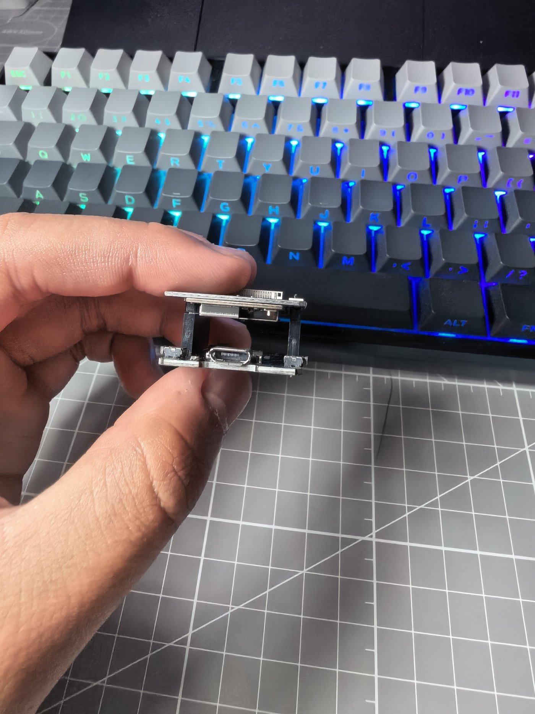
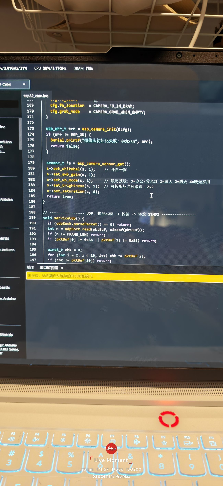
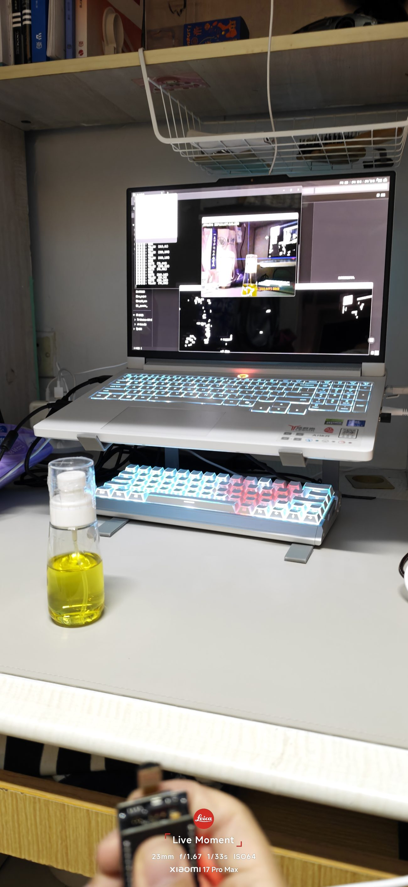
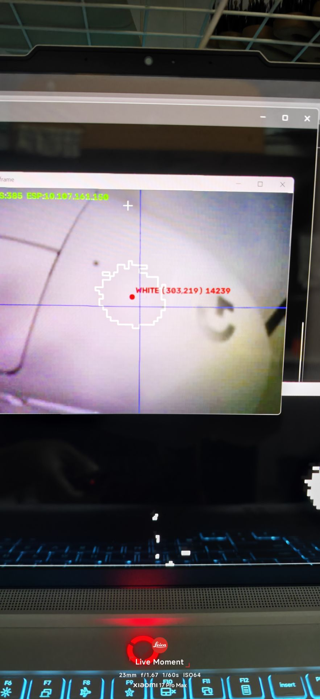
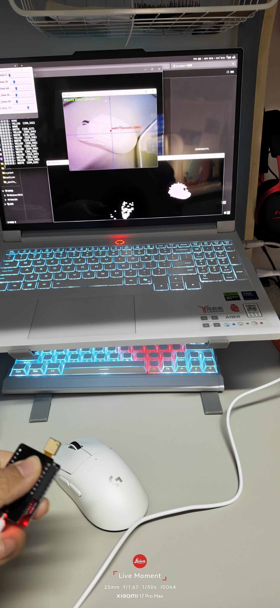

# 视觉组开发日志

> **队伍名称**：破囚战队
> **记录周期**：2026 年 9 月 19 日 — 10 月 19 日
> **文档编写**：宋至人
> **说明**：本文档为视觉组专项日志，统一以「视觉组」指代。
> **成员**：柳景源（主）；宋至人（辅）

---

## 一、组内职责与技术路线

视觉组负责机器人的"眼睛"：**图像采集链路、颜色识别算法、与主控的数据接口**。

我们的技术路线是"**先在电脑上跑通算法，再迁移到嵌入式端**"：

1. 电脑端用 **Python + OpenCV** 验证颜色识别逻辑；
2. 再基于 **ESP32-CAM** 做嵌入式部署与实机测试。

| 时间 | 里程碑 |
|---|---|
| 9/19 | Python + OpenCV 环境搭建，**色块颜色识别**跑通 |
| 9/25 | ESP32-CAM 烧录代码准备就绪 |
| 9/25-10/9 | 烧录软件故障排查（模板无法下载）→ 解决 |
| 10/13 | **第一次实机演示**：白色识别故障、曝光严重 |
| 10/16 | **第二次实机演示**：成功识别黄/白模块，曝光问题解决 |

---

## 二、硬件链路搭建

### 2.1 一条完整的"视觉链路"

项目早期，视觉组就提出了明确的硬件需求：

> "需要**摄像头加 USB 线**（两根都需要长一点），再就是 **USB TTL 模块**，不然电脑连不上 STM32，视觉程序就没得用了。"

这段话点出了关键：**视觉不是"一个摄像头就能跑"**，而是需要完整的三段链路：

```
摄像头 → USB 数据线 → 电脑/主控（USB TTL）
   ↑                        ↓
 图像采集              识别程序运行
```

### 2.2 线材补充：梯形线

9 月 25 日，调试中发现还缺少特定的**梯形连接线**，在群里提出"视觉组急需"。


*图 1：视觉组急需的梯形连接线（手持实物）*

> **教训**：视觉硬件链路的"最后一根线"往往最容易被忽略——**摄像头、数据线、TTL 模块、转接线，缺任何一环整个模块都无法工作**。采购清单应按"完整链路"核对。

### 2.3 摄像头选型：ESP32-CAM 低成本方案

在报销额度已基本用完的情况下（成本约束 400 元），采用 **ESP32-CAM + 降压器**（约 50 元，队员自费）作为低成本验证方案。

| 方案 | 成本 | 优点 | 缺点 |
|---|---|---|---|
| **ESP32-CAM** | ~50 元 | 便宜、集成 Wi-Fi、体积小 | 算力有限、图像质量一般 |
| 工业/USB 摄像头 | 100+ 元 | 图像质量高 | 成本高、需额外主控 |
| OpenMV 等视觉模组 | 200+ 元 | 专用视觉算法 | 远超预算 |

> **为什么选 ESP32-CAM**：在预算紧张、还要做两台车的前提下，**用最低成本验证"视觉能不能跑通"**是唯一现实的选择。

---

## 三、识别算法：从 RGB 到 HSV

### 3.1 环境搭建与色块识别（9 月 19 日）

在电脑上完成 **Python + OpenCV** 环境搭建，实现基础的**色块颜色识别**。


*图 2：Python + OpenCV 识别程序（VS Code 环境）*

### 3.2 为什么用 HSV 而不是 RGB

颜色识别的基本思路是把图像转到 **HSV 空间**，用色调（H）、饱和度（S）、亮度（V）的阈值范围分割目标颜色。

| 色彩空间 | 特点 | 适用性 |
|---|---|---|
| RGB | 三通道都随光照强度变化 | 阈值难统一 |
| **HSV** | **H（色相）对光照相对不敏感** | **适合颜色分割** |

举例：同一块白色方块，强光下 R/G/B 都高，阴影下都低，RGB 阈值几乎无法兼顾；而 HSV 中只要 H 落在中性区、S 足够低，就能较稳定地判为"白"。

### 3.3 识别目标

赛场道具分为两种：
- **能量单元**：白色立方体（30×30×30mm）；
- **能量核心**：黄色立方体。

视觉组的任务是**区分并定位白色方块**，为夹爪提供目标位置。

---

## 四、嵌入式部署：烧录问题排查

### 4.1 ESP32-CAM 烧录代码准备（9 月 25 日）

完成烧录代码准备，但随即遇到**烧录软件故障**：

> **问题**：烧录 ESP 的软件出现问题，**模板无法下载，烧录停滞**。

### 4.2 故障排查与解决（10 月 9 日）

经排查，问题出在烧录工具的模板获取环节（网络/资源缺失）。通过更换资源来源、重新配置烧录参数后，**烧录成功**。

> **经验**：嵌入式开发中，**"代码没问题但烧不进去"是高频故障**——先确认工具链完整（模板/驱动/端口），再怀疑代码。

---

## 五、实机测试：两次迭代

### 5.1 第一次实机演示（10 月 13 日）

**问题**：
1. **颜色识别白色出现故障**（无法识别白色目标）；
2. **曝光严重**——画面过曝，目标区域细节丢失。


*图 3：笔记本 + 摄像头 + 实机识别测试*

> **问题分析**：白色目标本身反射率高，在室内灯光下极易过曝；一旦过曝，像素的 V 值饱和、S 值失真，HSV 分割就失效。

### 5.2 第二次实机演示（10 月 16 日）

**成果**：
- **能够成功识别黄、白模块**；
- **曝光问题解决**。


*图 4：识别窗口——成功框选出黄/白目标*


*图 5：视觉调试环境（笔记本 + 车体 + 摄像头）*

**曝光问题的解决思路**（经验总结）：
1. **限制亮度的上限判断**：对 V 通道设置上限，避免过曝区域被误判为"纯白"；
2. **提高饱和度区分度**：白色 S 值低、黄色 S 值高，用 S 值辅助区分；
3. **控制环境光**：避免强光源直射目标。

> **后续待改进**：稳定性仍需提升（不同光照/角度下的鲁棒性）。

---

## 六、供电方案

### 6.1 当前状态：电脑临时供电

调试阶段，视觉模块由**电脑通过 USB 直接供电**——这不是车载状态。

### 6.2 车载供电方案讨论

视觉组与电控组讨论了两种方案：

| 方案 | 优点 | 风险 |
|---|---|---|
| 7.4V 直供 | 简单、少一级转换 | 需确认模块耐压 |
| **降压 5V** | 电压稳定、安全 | 多一级转换 |

**初步倾向**：确认 ESP32-CAM 输入范围后，优先采用**降压 5V**，与主控共用一路 5V，简化接线。

> **接口对接**：视觉模块的供电来自电控、识别结果要喂给电控。**两组必须提前对齐接口（电压/电流/串口协议），否则会卡在"线接不上/协议对不上"这种低级问题。**

---

## 七、问题汇总

| # | 问题 | 现象 | 原因 | 解决 |
|---|---|---|---|---|
| 1 | 链路不全 | 电脑连不上 STM32 | 缺 USB TTL | 补购 TTL |
| 2 | 线材不足 | 连接受限 | 缺梯形线 | 补购 |
| 3 | 烧录停滞 | 模板无法下载 | 烧录工具资源缺失 | 换资源、重配参数 |
| 4 | 白色识别失败 | 无法识别白块 | HSV 阈值/过曝 | 调阈值 |
| 5 | 曝光严重 | 画面过曝、细节丢失 | 白色反射率高 | 限制 V 上限、控光 |
| 6 | 供电不独立 | 依赖电脑 | 未做车载供电 | 降压 5V 方案 |

---

## 八、小结

视觉组完成了：**Python+OpenCV 色块识别 → ESP32-CAM 烧录部署 → 两次实机迭代 → 成功识别黄/白模块**。

**核心收获**：颜色识别看起来简单，但**真实光照下的"白"与"浅黄"边界非常模糊**。实验室阈值必须考虑赛场光照，而"曝光"往往是被忽视的第一杀手。

后续将继续：车载供电改造、阈值鲁棒性优化、与主控的识别结果串口协议对接。

---

*本文档为视觉组专项日志，总体设计见 [总体篇](./00-总体设计与开发日志.md)。*
